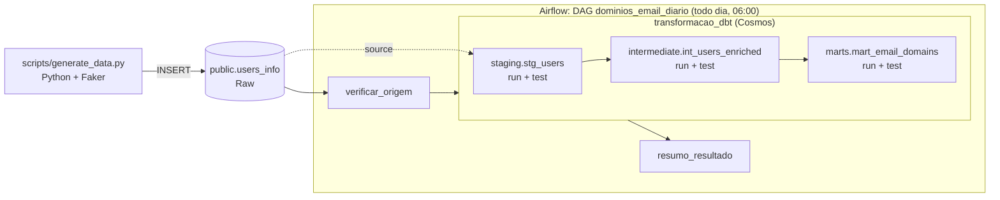

# XPTOZ — Domínios de e-mail mais utilizados

Pipeline de dados que identifica os domínios de e-mail mais usados nos cadastros de pessoas e a quantidade de registros de cada domínio. Os dados brutos ficam no **PostgreSQL**, as transformações são feitas em camadas com **dbt** e a execução diária é orquestrada pelo **Apache Airflow**.

**Sumário:** [Arquitetura](#arquitetura) · [Início rápido](#início-rápido) · [Configuração](#configuração) · [Execução](#execução) · [Camadas do dbt](#camadas-do-dbt) · [Orquestração](#orquestração-airflow) · [Qualidade e CI](#qualidade-e-ci) · [Evidências](#evidências) · [Requisitos do case](#atendimento-aos-requisitos-do-case) · [Solução de problemas](#solução-de-problemas) · [Limitações](#limitações-e-próximos-passos)

---

## Arquitetura



| Componente | Versão | Papel |
|---|---|---|
| PostgreSQL | 16 | Armazena os dados brutos e as camadas do dbt (Render ou container local) |
| Python + Faker | 3.12 / 40.43 | Gera e carrega os dados fictícios em `users_info` |
| dbt Core + dbt-postgres | 1.12 / 1.11 | Transformações em camadas: staging → intermediate → marts |
| Apache Airflow | 3.3.2 | Agendamento diário e orquestração dos modelos dbt |
| Astronomer Cosmos | 1.15 | Converte cada modelo dbt em tasks do Airflow (run + test) |
| Docker Compose | v2 | Ambiente local completo: Airflow (LocalExecutor) + Postgres |

O dbt roda em um **virtualenv isolado** dentro da imagem do Airflow (`/opt/dbt_venv`). As duas ferramentas compartilham várias dependências, e separá-las evita conflitos de versão.

### Fluxo de processamento

1. **Ingestão:** o script do case cria `public.users_info` e insere 1.000 cadastros fictícios por execução. E-mails repetidos são ignorados pela restrição `UNIQUE`.
2. **Verificação:** a DAG confirma que a origem existe e tem registros antes de acionar o dbt.
3. **Transformação:** o Cosmos executa os modelos dbt na ordem das dependências. Cada modelo é seguido dos seus testes, e uma falha interrompe as camadas seguintes.
4. **Resultado:** `marts.mart_email_domains` traz o total de cadastros por domínio, e a task `resumo_resultado` registra o ranking no log.

### Exemplo de resultado

Os números variam porque os dados são aleatórios.

| dominio_email | total_registros |
|---|---|
| EXAMPLE.ORG | 690 |
| EXAMPLE.COM | 661 |
| EXAMPLE.NET | 624 |

> **Por que só 3 domínios?** O script fornecido usa `fake.email()`, que por padrão gera apenas domínios reservados para exemplos (`example.com`, `example.net`, `example.org`, conforme a RFC 2606). O script foi mantido como fornecido; o pipeline funciona para qualquer quantidade de domínios.

## Estrutura do repositório

```
├── .github/workflows/ci.yml    # CI: lint, dbt build em Postgres efêmero e testes das DAGs
├── dags/
│   ├── dag_dominios_email.py   # DAG diária (06:00) que orquestra o dbt via Cosmos
│   └── smoke_test_ambiente.py  # verificação do ambiente (execução manual)
├── dbt/                        # projeto dbt
│   ├── dbt_project.yml         # schema e materialização de cada camada
│   ├── profiles.yml            # conexão via variáveis de ambiente (sem credenciais)
│   ├── macros/                 # generate_schema_name: schemas staging/intermediate/marts
│   ├── models/
│   │   ├── staging/            # _sources.yml, stg_users.sql, _staging.yml
│   │   ├── intermediate/       # int_users_enriched.sql, _intermediate.yml
│   │   └── marts/              # mart_email_domains.sql, _marts.yml
│   └── tests/                  # testes singulares
├── docs/
│   ├── consultas_validacao.sql # consultas para conferir cada camada
│   └── evidencias/             # prints das execuções
├── scripts/generate_data.py    # script do case, lendo credenciais do ambiente
├── tests/test_dags.py          # testes de integridade das DAGs (pytest)
├── Dockerfile                  # Airflow 3.3.2 + Cosmos + dbt em venv isolado
├── docker-compose.yml          # Airflow (LocalExecutor) + Postgres local
├── .env.example                # modelo de variáveis de ambiente
├── Makefile                    # atalhos dos comandos
└── pyproject.toml              # configuração do lint (ruff)
```

## Início rápido

Pré-requisitos: **Docker Desktop** (ou Docker Engine + Compose v2) com pelo menos 4 GB de memória e 15 GB de disco livres, e **Git**.

```bash
git clone https://github.com/DevLucas-Almeida/xptoz-dominios-email.git
cd xptoz-dominios-email

cp .env.example .env    # Windows: copy .env.example .env
# preencha FERNET_KEY e AIRFLOW__API_AUTH__JWT_SECRET (veja "Segredos do Airflow")

docker compose build
docker compose up -d
docker compose run --rm airflow-cli python /opt/airflow/scripts/generate_data.py
```

Depois acesse **http://localhost:8080** (usuário `airflow`, senha `airflow`), ative a DAG **`dominios_email_diario`** pelo toggle e clique em **Trigger**.

## Configuração

### Variáveis de ambiente

Todas as credenciais ficam no `.env`, que está no `.gitignore` e nunca é versionado. O `.env.example` traz o modelo comentado. As variáveis `PG_*` definem o banco do desafio e são lidas pelo script de carga, pelo dbt (`profiles.yml` usa `env_var()`) e pelas DAGs.

| Variável | Descrição |
|---|---|
| `PG_HOST`, `PG_PORT`, `PG_USER`, `PG_PASSWORD`, `PG_DBNAME` | Conexão com o Postgres do desafio |
| `PG_SSLMODE` | `disable` no Postgres local; `require` no Render |
| `LOCAL_PG_USER`, `LOCAL_PG_PASSWORD`, `LOCAL_PG_DB` | Credenciais do container `warehouse` (só valem na máquina local) |
| `FERNET_KEY` | Chave de criptografia de connections e variables do Airflow |
| `AIRFLOW__API_AUTH__JWT_SECRET` | Segredo compartilhado entre o api-server e o scheduler |
| `AIRFLOW_UID` | No Linux, o resultado de `id -u`; no Windows e no macOS, mantenha `50000` |
| `_AIRFLOW_WWW_USER_USERNAME`, `_AIRFLOW_WWW_USER_PASSWORD` | Login da UI do Airflow |

### Banco de dados: local ou Render

**Opção A: Postgres local (container `warehouse`).** Mantenha os valores padrão do `.env.example`. O banco fica acessível em `localhost:5433` para inspeção com DBeaver ou `psql`.

**Opção B: Postgres no Render.**

1. No [painel do Render](https://dashboard.render.com/new/database), crie um **Postgres** (plano Free, PostgreSQL 16, região Virginia).
2. Quando o status for *Available*, abra **Connect → External**.
3. Preencha no `.env` cada parte da conexão separadamente:
   ```
   PG_HOST=dpg-xxxxxxxx-a.virginia-postgres.render.com   # host EXTERNO, sem "postgresql://"
   PG_PORT=5432
   PG_USER=...
   PG_PASSWORD=...
   PG_DBNAME=...
   PG_SSLMODE=require                                    # o Render recusa conexões sem TLS
   ```
4. Recrie os containers para aplicar o novo `.env`: `docker compose up -d --force-recreate`.

> O plano gratuito do Render expira após 30 dias (com 14 dias de carência). Se o banco expirar, use a opção A ou recrie a instância e rode a carga novamente.

### Segredos do Airflow

Linux, macOS ou qualquer ambiente com Python e `cryptography`:

```bash
python -c "from cryptography.fernet import Fernet; print(Fernet.generate_key().decode())"   # FERNET_KEY
python -c "import secrets; print(secrets.token_urlsafe(32))"                                # JWT_SECRET
```

Windows (PowerShell, sem Python):

```powershell
# FERNET_KEY
$b = New-Object byte[] 32; [Security.Cryptography.RandomNumberGenerator]::Create().GetBytes($b); [Convert]::ToBase64String($b).Replace('+','-').Replace('/','_')
# AIRFLOW__API_AUTH__JWT_SECRET
[guid]::NewGuid().ToString("N") + [guid]::NewGuid().ToString("N")
```

## Execução

| Etapa | Com make | Sem make |
|---|---|---|
| Construir a imagem | `make build` | `docker compose build` |
| Subir o ambiente | `make up` | `docker compose up -d` |
| Carregar os dados | `make load-data` | `docker compose run --rm airflow-cli python /opt/airflow/scripts/generate_data.py` |
| Contar registros | `make db-count` | ver `Makefile` |
| Validar a conexão do dbt | `make dbt-debug` | `docker compose run --rm airflow-cli bash -c "dbt debug"` |
| Rodar modelos e testes | `make dbt-build` | `docker compose run --rm airflow-cli bash -c "dbt build"` |
| Documentação e lineage | `make dbt-docs` | `docker compose run --rm -p 8081:8081 airflow-cli bash -c "dbt docs generate && dbt docs serve --host 0.0.0.0 --port 8081 --no-browser"` |
| Rodar a DAG diária pelo terminal | `make dag-test` | `docker compose run --rm airflow-cli airflow dags test dominios_email_diario` |
| Testar o ambiente | `make smoke-test` | `docker compose run --rm airflow-cli airflow dags test smoke_test_ambiente` |
| Parar | `make down` | `docker compose down` |
| Parar e apagar os dados locais | `make reset` | `docker compose down -v` |

Depois de `docker compose up -d`, todos os serviços devem aparecer como `healthy` em `docker compose ps`. O `airflow-init` roda uma vez e termina com código 0.

Para conferir cada camada, use as consultas de [`docs/consultas_validacao.sql`](docs/consultas_validacao.sql): volumes por camada, ranking final, padronização, extração de nomes e lotes do incremental.

## Camadas do dbt

| Camada | Modelo | Materialização | Conteúdo |
|---|---|---|---|
| Raw | `public.users_info` (source) | tabela de origem | Dados como gerados pelo script: `id`, `nome`, `email`, `idade`, `cidade` |
| Staging | `staging.stg_users` | incremental (`unique_key=id`) | Textos em maiúsculas e sem espaços extras, vazios como NULL, idade validada, `created_at` e `updated_at` |
| Intermediate | `intermediate.int_users_enriched` | table | Inclui `primeiro_nome`, `ultimo_nome` e `dominio_email` |
| Marts | `marts.mart_email_domains` | table | `dominio_email`, `total_registros`, `created_at`, `updated_at` |

Cada camada fica no seu próprio schema do Postgres. A macro `generate_schema_name` evita o prefixo padrão do dbt (`public_staging`).

### Decisões de modelagem

- **`created_at` / `updated_at` na staging:** o modelo é incremental com merge por `id`. Um registro novo recebe `now()` nos dois campos. Um registro existente mantém o `created_at` original, e o `updated_at` só muda quando algum campo foi alterado na origem. Assim os campos de controle têm significado estável entre as execuções diárias, em vez de mudarem a cada leitura.
- **Pronomes de tratamento:** o Faker gera cerca de 19% dos nomes com `Dr.`, `Dra.`, `Sr.`, `Sra.` ou `Srta.`. Eles são removidos antes de separar o nome, para que o primeiro nome não seja, por exemplo, `DR.`. A coluna `nome` mantém o nome completo original.
- **Último nome:** é o último token do nome. Partículas como `DA` e `DAS` ficam no meio e não afetam o resultado (`ENRICO DA ROCHA` → `ROCHA`).
- **Domínio:** é o trecho após o `@`. Como a staging padroniza os textos em maiúsculas, os domínios aparecem como `EXAMPLE.COM`. Domínios de e-mail não diferenciam maiúsculas de minúsculas, então a contagem não é afetada.
- **`created_at` / `updated_at` no mart:** `created_at` é quando o primeiro cadastro do domínio entrou na staging; `updated_at` é quando a agregação foi recalculada.

### Testes do dbt

`dbt build` executa os modelos e **25 testes** na ordem das dependências.

- **Genéricos:** `unique` e `not_null` nas chaves da origem e de cada camada; `not_null` em `primeiro_nome`, `dominio_email` e nos campos de controle.
- **Singulares (`dbt/tests/`):**

| Teste | O que garante |
|---|---|
| `assert_staging_completa_em_relacao_a_origem` | Nenhum registro da origem fica de fora da staging |
| `assert_staging_textos_em_maiusculas` | Textos em maiúsculas e sem espaços extras |
| `assert_intermediate_nomes_e_dominios_validos` | Primeiro nome sem pronome; nomes e domínio extraídos corretamente |
| `assert_mart_soma_igual_total_usuarios` | A soma do mart é igual ao total de cadastros: nada perdido nem duplicado na agregação |

A documentação do projeto, com descrição de cada coluna e o grafo de linhagem, é gerada com `make dbt-docs` e fica em http://localhost:8081.

## Orquestração (Airflow)

A DAG **`dominios_email_diario`** ([`dags/dag_dominios_email.py`](dags/dag_dominios_email.py)) executa o pipeline completo uma vez por dia.

| Configuração | Valor |
|---|---|
| Agendamento | `0 6 * * *`: todo dia às 06:00, fuso `America/Sao_Paulo` |
| Catchup | Desativado: não reprocessa dias passados quando a DAG é ativada |
| Execuções simultâneas | No máximo 1 |
| Retentativas | 2, com intervalo de 5 minutos; a verificação da origem não tem retentativa |
| Timeout da execução | 30 minutos |

### Tasks

```
verificar_origem
  → transformacao_dbt
      raw_users_info (testes da source)
        → stg_users.run → stg_users.test
            → int_users_enriched.run → int_users_enriched.test
                → mart_email_domains.run → mart_email_domains.test
      + testes que dependem de mais de um modelo, em tasks próprias
  → resumo_resultado
```

- **`verificar_origem`:** falha imediatamente, sem retentativas, se `public.users_info` não existir ou estiver vazia. A mensagem de erro indica como resolver.
- **`transformacao_dbt`:** grupo gerado pelo [Astronomer Cosmos](https://github.com/astronomer/astronomer-cosmos) a partir do projeto dbt. Cada modelo vira uma task de `run` seguida de uma de `test`, e as dependências vêm dos `ref()` do dbt. Com isso, a ordem staging → intermediate → marts é garantida, uma falha de teste interrompe as camadas seguintes e o status de cada modelo pode ser acompanhado individualmente na UI.
- **`resumo_resultado`:** imprime no log o ranking de domínios, com quantidade e percentual, e publica o resultado em XCom.

### Como executar

1. Acesse http://localhost:8080 e ative a DAG `dominios_email_diario` pelo toggle. DAGs novas começam pausadas.
2. A partir daí, ela roda automaticamente todos os dias às 06:00. Para executar na hora, clique em **Trigger**.
3. Acompanhe o andamento em **Grid** ou **Graph**. O resultado final aparece no log da task `resumo_resultado`.

**Para demonstrar a atualização dos resultados:** rode `make load-data` para inserir novos cadastros e dispare a DAG de novo. Os totais em `marts.mart_email_domains` aumentam, e os registros antigos mantêm o `created_at` original na staging.

## Qualidade e CI

O workflow [`.github/workflows/ci.yml`](.github/workflows/ci.yml) roda a cada push na `main` e em pull requests, com três jobs:

| Job | O que faz |
|---|---|
| **Lint** | `ruff check` nas DAGs, no script e nos testes |
| **dbt build** | Sobe um Postgres 16 efêmero, roda o script de carga e executa `dbt build` duas vezes: carga completa e depois incremental, com uma nova carga entre elas |
| **Integridade das DAGs** | Instala Airflow 3.3.2 + Cosmos e roda `pytest`: DAGs sem erro de importação, agendamento diário, ordem das camadas e task de teste para cada modelo |

Outras práticas adotadas:
- credenciais apenas em variáveis de ambiente;
- versões fixadas em `requirements*.txt`;
- dbt isolado do Airflow;
- falha antecipada quando não há dados;
- retentativas com intervalo;
- `.gitattributes` forçando finais de linha LF, para os containers funcionarem em clones feitos no Windows.

## Evidências

Os prints estão em [`docs/evidencias/`](docs/evidencias/), e a execução completa está no vídeo demonstrativo: **[link do Loom](#)**.

| Evidência | Arquivo |
|---|---|
| DAG executada com sucesso, com todas as tasks e camadas | [01_airflow_graph.png](docs/evidencias/01_airflow_graph.png) |
| Agendamento diário configurado (`0 6 * * *`, America/Sao_Paulo) | [02_airflow_agendamento.png](docs/evidencias/02_airflow_agendamento.png) |
| Histórico de execuções (Grid) | [03_airflow_grid.png](docs/evidencias/03_airflow_grid.png) |
| Ranking de domínios no log de `resumo_resultado` | [04_resumo_resultado_log.png](docs/evidencias/04_resumo_resultado_log.png) |
| `dbt build` com 25 testes aprovados | [05_dbt_build.png](docs/evidencias/05_dbt_build.png) |
| Tabela final `marts.mart_email_domains` | [06_mart_resultado.png](docs/evidencias/06_mart_resultado.png) |
| Linhagem dos modelos no dbt docs | [07_dbt_lineage.png](docs/evidencias/07_dbt_lineage.png) |


## Atendimento aos requisitos do case

| Requisito | Onde está atendido |
|---|---|
| Tabela `users_info` no PostgreSQL, populada pelo script fornecido | [`scripts/generate_data.py`](scripts/generate_data.py), com o código original e credenciais via ambiente; banco no Render ou local |
| Staging: maiúsculas, normalização, `created_at` e `updated_at` | [`stg_users.sql`](dbt/models/staging/stg_users.sql) |
| Intermediate: primeiro nome, último nome e domínio do e-mail | [`int_users_enriched.sql`](dbt/models/intermediate/int_users_enriched.sql) |
| Marts: total de registros por domínio | [`mart_email_domains.sql`](dbt/models/marts/mart_email_domains.sql) |
| DAG no Airflow que executa os modelos dbt | [`dag_dominios_email.py`](dags/dag_dominios_email.py), via Cosmos |
| Execução automática uma vez ao dia | `schedule="0 6 * * *"`, fuso America/Sao_Paulo |
| Respeito às dependências entre camadas | Tasks geradas a partir dos `ref()` do dbt; testes entre as camadas |
| Acompanhamento do status pelo Airflow | Uma task de run e uma de test por modelo, mais o resumo no log |
| Credenciais sem exposição | `.env` fora do Git, `.env.example` como modelo, `env_var()` no dbt |
| README, evidências e vídeo | Este documento, [`docs/evidencias/`](docs/evidencias/) e o vídeo no Loom |

## Solução de problemas

| Sintoma | Causa e solução |
|---|---|
| `could not translate host name "dpg-...-a"` | Foi usado o host **interno** do Render. Use o host da aba **External** (termina em `.render.com`). |
| `could not translate host name "postgresql://..."` | A URL completa foi colada em `PG_HOST`. Preencha host, usuário, senha e banco em variáveis separadas. |
| Erro de SSL ou timeout com o Render | Use `PG_SSLMODE=require` e confira se a rede permite saída na porta 5432. |
| `required variable AIRFLOW__API_AUTH__JWT_SECRET is missing` | O `.env` não existe na pasta do projeto ou está sem esse valor. |
| Mudanças no `.env` não fazem efeito | Recrie os containers: `docker compose up -d --force-recreate`. |
| `unable to find user root` no build | A imagem base foi baixada corrompida, geralmente por falta de disco. Rode `docker builder prune -af`, `docker rmi -f apache/airflow:3.3.2-python3.12` e repita o build. |
| Docker Desktop fecha com "only one connection allowed" | O WSL travou. Rode `wsl --shutdown` e abra o Docker de novo. Se persistir, aumente a memória do WSL em `%USERPROFILE%\.wslconfig`. |
| `Wsl/UpdatePackage/0x80070070` | Disco cheio. Libere pelo menos 15 GB no disco do Docker. |
| Erros de permissão ou lentidão no Windows | Evite pastas sincronizadas pelo OneDrive; use algo como `C:\projetos\`. |
| Erros de permissão em `logs/` ou `dbt/` no Linux | Defina `AIRFLOW_UID` com o resultado de `id -u` no `.env`. |
| Porta 8080 ou 5433 ocupada | Altere o lado esquerdo do mapeamento em `ports:` no `docker-compose.yml`. |
| DAG não aparece na UI | O dag-processor leva até cerca de 1 minuto para ler DAGs novas. Na primeira leitura, o Cosmos executa `dbt ls`, que leva alguns segundos e depois fica em cache. |

## Limitações e próximos passos

- **Volume de dados:** a staging relê a origem inteira a cada execução, o que é adequado para o volume do case. Para volumes maiores, o incremental pode filtrar só os registros novos ou alterados, usando uma coluna de atualização na origem.
- **Exclusões na origem:** registros apagados de `users_info` não são removidos da staging. Se isso for necessário, há duas opções: um *soft delete* com uma coluna de status, ou um snapshot do dbt.
- **Sobrenomes compostos sem partícula** (ex.: `CASA GRANDE`) retornam apenas o último token (`GRANDE`). Uma solução completa exigiria um dicionário de sobrenomes.
- **Domínios:** o script usa domínios de exemplo do Faker. Com dados reais, seria útil normalizar variações do mesmo provedor (ex.: `HOTMAIL.COM` e `HOTMAIL.COM.BR`) em uma tabela de referência.
- **Execução em produção:** em um ambiente gerenciado (MWAA, Astronomer, Cloud Composer), as credenciais iriam para um *secrets backend*, e o Postgres sairia do plano gratuito do Render.
